<div align="center">

# WooCommerce Stock Inquiry

**Quote requests, product inquiries and lead management for WooCommerce.**

Free and open source. Version 3.0.0, "Inquiry Management System".

   

</div>

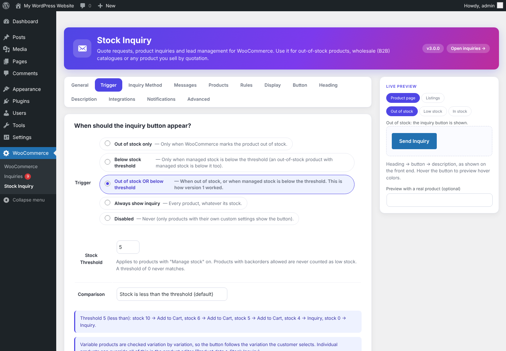

Replace **Add to Cart** with a customizable inquiry button, save every inquiry in a simple inbox inside WordPress, update its status and email the customer. WooCommerce stock data is never changed, and Add to Cart returns by itself when a product no longer matches your rule.

> Automatic WooCommerce integration needs **no shortcode**. Elementor is only needed for the optional Elementor Popup method.

## Contents

1. [What it is used for](#what-it-is-used-for)
2. [Screenshots](#screenshots)
3. [Features](#features)
4. [Installation and quick start](#installation-and-quick-start)
5. [B2B and quotation workflow](#b2b-and-quotation-workflow)
6. [Stock rules](#stock-rules)
7. [Inquiry methods](#inquiry-methods)
8. [Inquiry management (WooCommerce > Inquiries)](#inquiry-management)
9. [Rules by category and multiple WhatsApp numbers](#rules-by-category-and-multiple-whatsapp-numbers)
10. [Settings reference](#settings-reference)
11. [Developers](#developers)
12. [Privacy and security](#privacy-and-security)
13. [Upgrading](#upgrading)
14. [FAQ and troubleshooting](#faq-and-troubleshooting)
15. [Version history and roadmap](#version-history-and-roadmap)
16. [Support and license](#support-and-license)

## What it is used for

| Use case | How |
|---|---|
| **Out-of-stock or low-stock products** | Keep the product visible; customers ask instead of leaving. |
| **B2B and wholesale catalogues** | A "Request a Quote" button on selected products or whole categories, whatever their stock. |
| **Made-to-order, bulk and custom products** | Collect the request, follow it up, close it. |
| **Department routing** | Furniture questions to one WhatsApp number, electronics to another. |

## Screenshots

### Settings

| | |
|---|---|
| <br>**Settings overview** with sticky live preview | 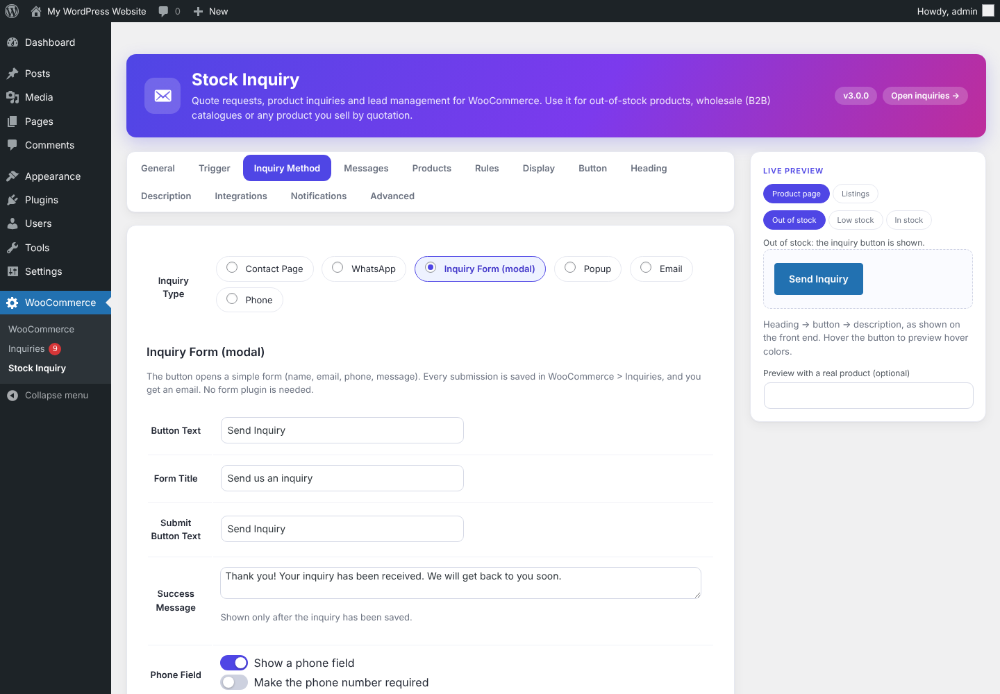<br>**Inquiry method**: Contact Page, WhatsApp, Inquiry Form, Popup, Email, Phone |
| 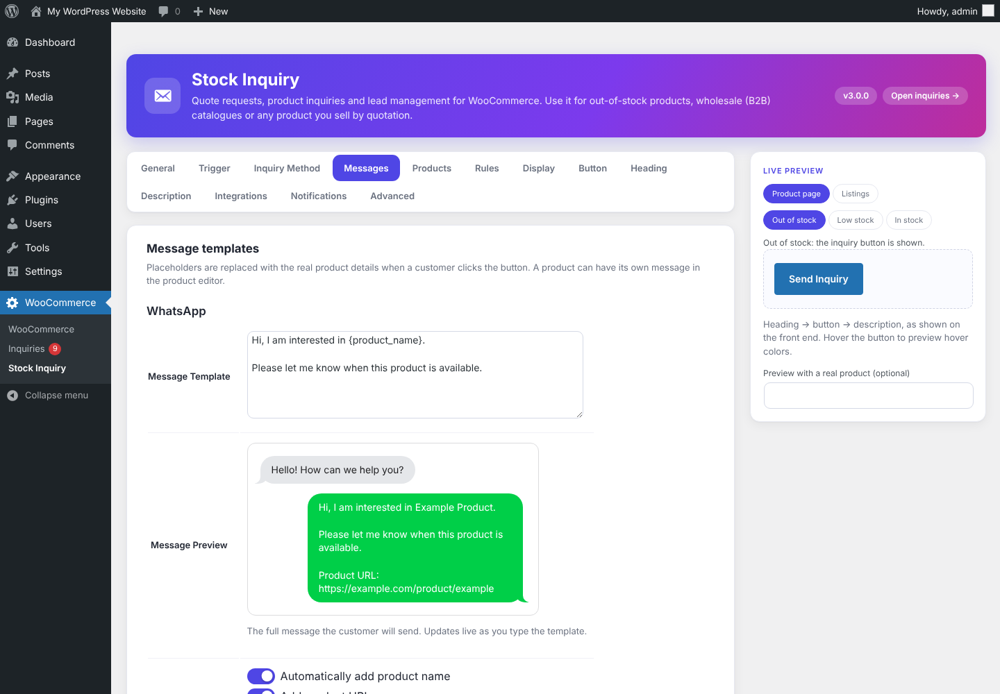<br>**Message templates** with placeholders | 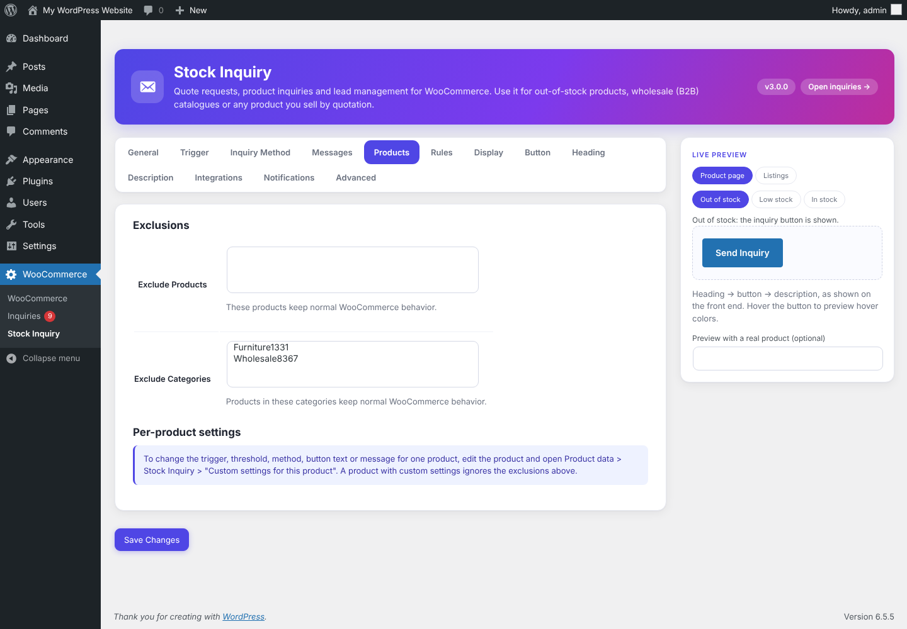<br>**Products**: exclude products and categories |
| 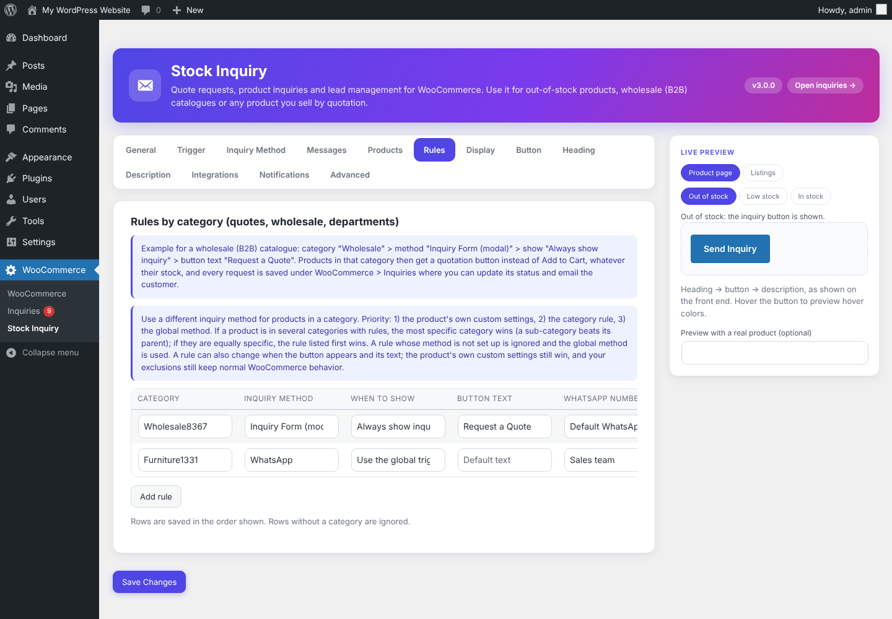<br>**Rules by category**, for example "Request a Quote" | 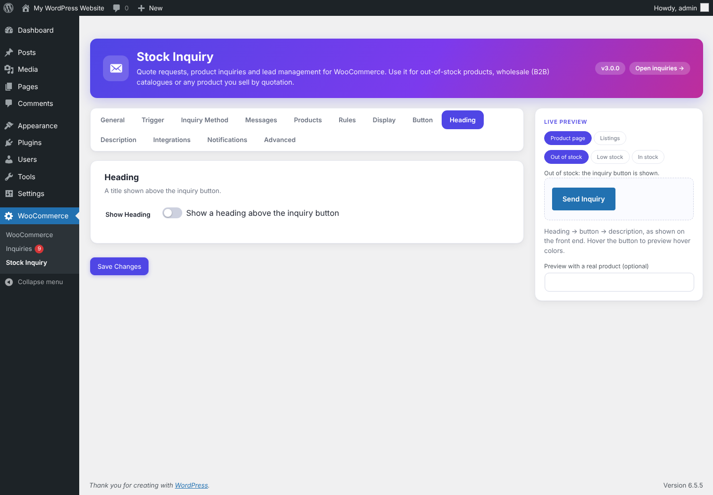<br>**Heading, button and description** styling |
| 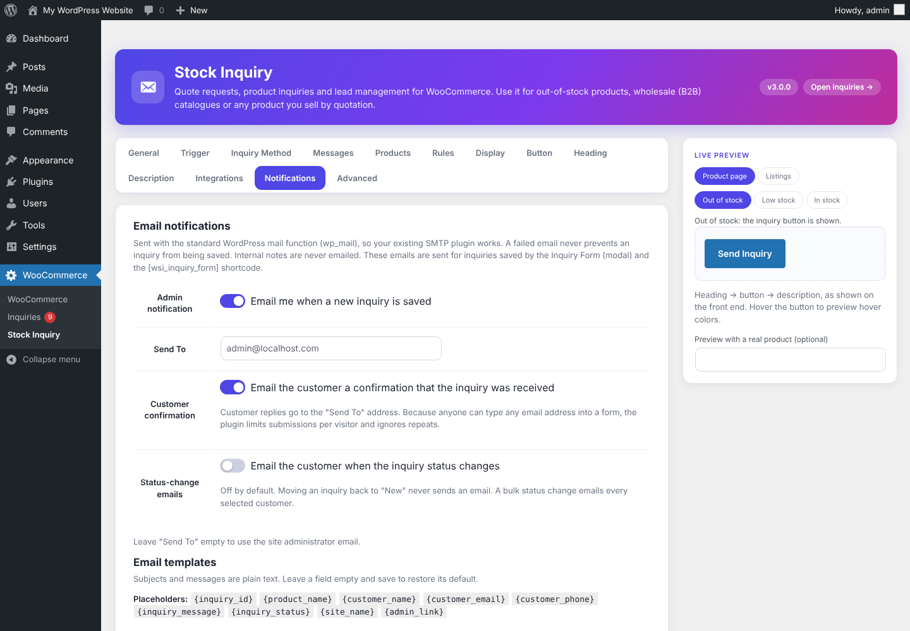<br>**Notifications**: admin, customer and status emails | 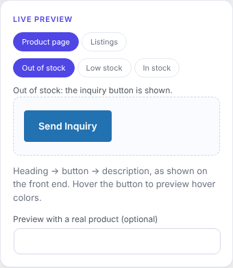<br>**Live preview** for product page and listings |

### Inquiries and quotes

| | |
|---|---|
| 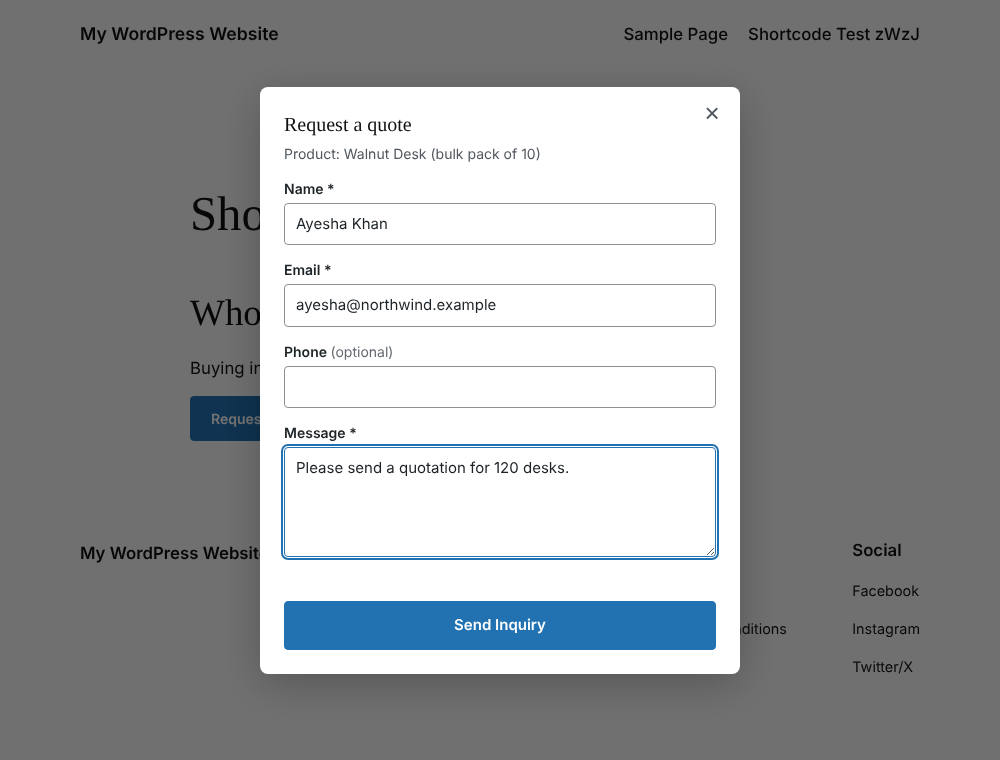<br>**Request a Quote form** on the product page | 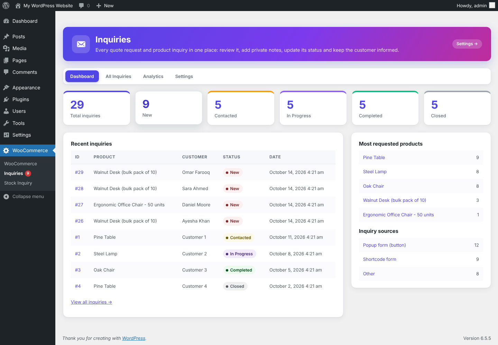<br>**Dashboard**: totals, statuses, recent inquiries |
| 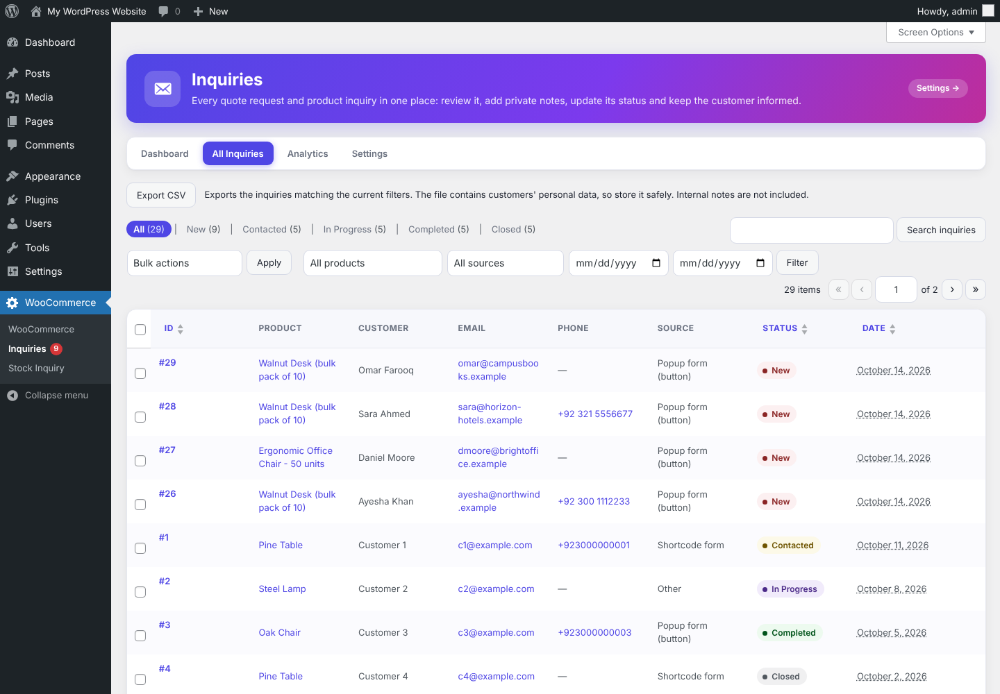<br>**All Inquiries**: search, filters, bulk actions, CSV export | 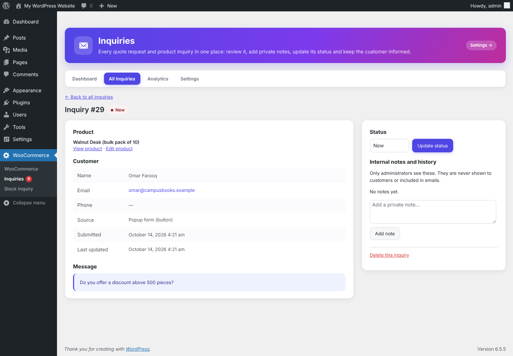<br>**Inquiry details**: status, private notes, history |
| 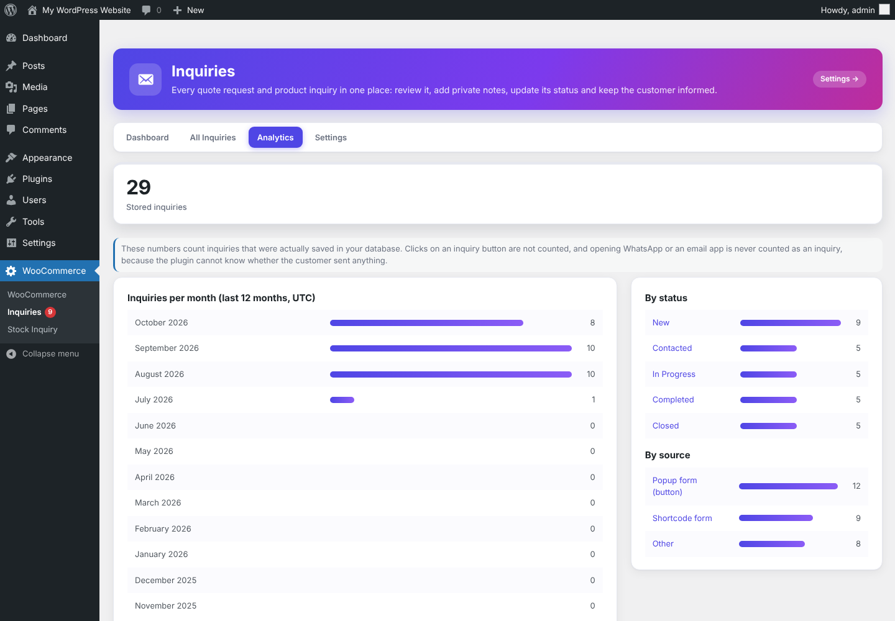<br>**Analytics** from stored inquiries | |

## Features

**Storefront**
- Stock rules: out of stock, below a threshold, either, always, or disabled. Variable products follow the selected variation.
- Six inquiry methods: Inquiry Form (modal), Contact Page, WhatsApp, Elementor Popup, Email, Phone.
- Per-product overrides and per-category rules (method, when to show, button text, WhatsApp number).
- Product and category exclusions; shared placeholders in every message; location switches (single product, shop, categories, search, related, upsells, cross-sells).
- Optional `[wsi_button]` and `[wsi_inquiry_form]` shortcodes. Works with WooCommerce templates and Elementor product layouts.

**Inquiry management**
- Inquiries saved in your database, with a dashboard, search, filters, sorting, pagination and bulk actions.
- Five statuses (New, Contacted, In Progress, Completed, Closed) with history; private internal notes.
- Email notifications to you and the customer with editable templates.
- Analytics and CSV export built from stored inquiries.

**Quality**
- No external requests, tracking or telemetry. Capability and nonce checks, prepared SQL, escaped output. WordPress personal data export and erase.

## Installation and quick start

1. Upload the ZIP at **Plugins > Add New Plugin > Upload Plugin** and activate (WooCommerce must be active).
2. Open **WooCommerce > Stock Inquiry**. Pick a trigger and an inquiry method, then save. Use the Test button to check the link.
3. Open a product that matches your rule to see the button. Inquiries from the Inquiry Form appear under **WooCommerce > Inquiries**.

## B2B and quotation workflow

1. **Rules** tab: add a rule for your category, for example *Wholesale* > method **Inquiry Form (modal)** > show **Always show inquiry** > button text **Request a Quote**.
2. Products in that category show a quote button instead of Add to Cart, regardless of stock. Other products behave as before.
3. A customer fills in name, email, phone and message. The request is saved first; the success message appears only after it is stored.
4. You get an email and a new row under **WooCommerce > Inquiries** (status **New**). The customer can get a confirmation email.
5. Open the inquiry, add private notes and move it through **New, Contacted, In Progress, Completed, Closed**. Optionally the customer is emailed on each status change.
6. Review **Analytics** and export the list to **CSV** when needed.


## Stock rules

Pick one **trigger** under *WooCommerce > Stock Inquiry > Trigger*:

| Trigger | Inquiry button appears when |
|---|---|
| Out of stock only | WooCommerce marks the product out of stock |
| Below stock threshold | managed stock is below the threshold |
| Out of stock OR below threshold | either of the above (the version 1 behavior, default) |
| Always show inquiry | always |
| Disabled | never (except products with their own settings) |

Example with threshold **5** and "Out of stock OR below threshold":

| Stock | Result |
|---:|---|
| 10, 6 | Add to Cart |
| 5 | Add to Cart (the comparison is "less than"; switch to "less than or equal" to include 5) |
| 4, 1 | Inquiry |
| 0 | Inquiry |

Rules that always apply: products with **backorders allowed** stay purchasable; products **without managed stock** are only affected by "out of stock"; a threshold of 0 never matches; **excluded** products and categories keep normal WooCommerce behavior (unless the product has its own custom settings).

### Variable products

Each variation is judged on its own stock. With a T-Shirt (Small 0, Medium 10, Large 2, XL 0) and "Out of stock OR below threshold", threshold 1:

- every variation unavailable: the form is replaced by the inquiry button;
- some unavailable: the normal form stays, and the button appears when a variation that needs it is selected and disappears again when the customer picks another variation, resets the choice, or the combination is unavailable;
- none unavailable: normal WooCommerce.

This uses WooCommerce's own variation events (`found_variation`, `reset_data`, `hide_variation`) and the per-variation data WooCommerce already sends, including AJAX-loaded variations. Without JavaScript the normal form is shown.

### Product-level overrides

Edit a product > **Product data > Stock Inquiry**. Choose *Use global settings* or *Custom settings for this product*, then optionally set: trigger (including *Always* and *Disabled*), threshold, inquiry method, button text and a custom message (used by WhatsApp, Email and Popup). Stored as post meta (`_wsi_*`); no extra tables. Switching a product back to global removes its data. Variations use their parent product's override.

## Inquiry methods

- **Contact Page**: sends the customer to your page with `?wsi_product=ID&wsi_product_name=...&wsi_product_url=...` (and `wsi_variation=ID` for a variation). Use `[wsi_product]`, `[wsi_product field="url|id|sku|price"]` to pre-fill a form.
- **WhatsApp**: `https://wa.me/<number>?text=...` with a message built from your template. Numbers need an international format (8 to 15 digits, no leading zero after the country code). Line breaks are normalized and the message is URL-encoded.
- **Elementor Popup** (needs Elementor Pro): choose an existing popup under *Inquiry Method > Popup*. Put your own form inside the popup. When the button is clicked the plugin opens it and fills any field or element carrying these CSS classes: `wsi-product-name`, `wsi-product-url`, `wsi-product-id`, `wsi-product-sku`, `wsi-product-price`, `wsi-message`. The product is also available as `window.wsiProduct` and the `wsi:product` jQuery event. The plugin is not a form builder and works with any form that lives in the popup.
- **Email**: a `mailto:` link with subject and message filled in. It opens the customer's own email app. The website does not send mail, so delivery is not and cannot be confirmed.
- **Phone**: a `tel:` link. International numbers keep their `+`; a leading `00` becomes `+`.

New methods can be added with the `wsi_inquiry_methods` filter by implementing `WSI_Inquiry_Method`.


### Placeholders

Available in the WhatsApp message, email subject and message, and a product's custom message: `{product_id}` `{product_name}` `{product_url}` `{sku}` `{price}` `{regular_price}` `{sale_price}` `{stock_quantity}` `{stock_status}` `{category}` `{site_name}` `{site_url}`. Unavailable values (no SKU, no sale, unmanaged stock) are empty. For a variation, `{product_name}`, `{sku}`, `{price}` and the stock values are the variation's, and `{product_url}` pre-selects it. Add your own with the `wsi_placeholder_values` filter.

Example WhatsApp template:

```
Hello,

I am interested in this product:

Product: {product_name}
SKU: {sku}
Price: {price}

Product link:
{product_url}

Thank you.
```


### Display

- Single product page: *Before*, *Replace* or *After* Add to Cart.
- Listings, each switchable: Shop, Category/tag archives, Search, Related, Upsells, Cross-sells, Other product grids. Locations come from WooCommerce's loop context. A theme or builder that prints its own grid may be reported as "Other".
- Heading, description and credit each have their own single-page / listing switches.

### Shortcodes

`[wsi_button]`, `[wsi_button product_id="123"]`, `[wsi_button text="Ask us" method="whatsapp"]`. It prints the button only when the product's stock rule says an inquiry is needed. Only published products are rendered.

```
[wsi_inquiry_form]                                      current product
[wsi_inquiry_form product_id="123" text="Ask about this" title="Request a quote"]
[wsi_inquiry_form send="whatsapp"]                      offer "Continue on WhatsApp" after saving
[wsi_inquiry_form only_if_needed="yes"]                 print only when the stock rule needs an inquiry
```

### Elementor compatibility

The core plugin uses WooCommerce hooks only (`woocommerce_loop_add_to_cart_link`, `wc_get_template`, `woocommerce_available_variation`), so Elementor WooCommerce widgets that call those templates are covered. Widgets that print their own markup without those hooks need the `[wsi_button]` shortcode. Elementor-specific code is isolated in `WSI_Elementor` / `WSI_Popup` and only used by the Popup method.

## Inquiry management

Choose **Inquiry Form (modal)** under **Inquiry Method**. The button opens a modal with name, email, phone (optional) and message. After the server confirms the inquiry was **saved**, the visitor sees the success message.


Inquiries appear in **WooCommerce > Inquiries**:

- **Dashboard**: totals, the five statuses, recent inquiries, most requested products, sources.
- **All Inquiries**: search, filters (status, product, source, date), sorting, pagination, bulk status change, bulk delete with confirmation, **Export CSV**.
- **Details**: product (image and link; the stored name is used if the product was deleted), customer, message, status, private notes and history.
- **Analytics**: totals, by status, by source, most requested products, 12-month trend. Button clicks are not tracked in 3.0.0 (planned for 3.1.0), and opening WhatsApp or an email app is never counted as an inquiry.


### Emails

**Settings > Notifications**: an admin notification, a customer confirmation, and an optional status-change email. Each has an editable subject and plain-text message with placeholders `{inquiry_id}` `{product_name}` `{customer_name}` `{customer_email}` `{customer_phone}` `{inquiry_message}` `{inquiry_status}` `{site_name}` and `{admin_link}` (admin email only).

Defaults: admin on, customer confirmation on for new installs, status emails off. Sent with `wp_mail()`, so any SMTP plugin works. A failed email never stops an inquiry from being saved, and internal notes are never emailed. Use **Send a test email** to check delivery.


### CSV export

Exports the current search and filters. UTF-8 with BOM for Excel, safe against spreadsheet formula injection, streamed in batches of 500, internal notes never included. Requires the manage-WooCommerce capability and a nonce.

## Rules by category and multiple WhatsApp numbers

**Rules** tab: choose a different inquiry method per product category, and optionally when the button shows and its text. Priority: the product's own custom settings, then the category rule, then the global settings. With several matching categories the most specific one wins (a sub-category beats its parent), then the rule listed first. A rule whose method is not set up is ignored. Exclusions and WooCommerce stock behaviour are unchanged, and stores without rules do no extra work.

**More WhatsApp numbers** (Inquiry Method > WhatsApp): add a name, an international number and an optional message template for each department. The existing number stays the default and is the fallback. Pick a number per category rule or per product. Message order: product message, number message, global message. Nothing is sent automatically and no WhatsApp Business API is used.

## Settings reference

| Tab | Controls |
|---|---|
| General | Enable the plugin |
| Trigger | Trigger mode, threshold, comparison, live example |
| Inquiry Method | Method, button text, destination (page, numbers, address, popup, form texts) and a Test button |
| Messages | WhatsApp template, email subject and message, placeholder list, previews |
| Products | Excluded products and categories, pointer to per-product settings |
| Rules | Category rules and their WhatsApp numbers |
| Display | Single page, position, listing locations |
| Button / Heading / Description | Typography, colours, padding, alignment, where to show |
| Integrations | Status of WhatsApp, Elementor and Elementor Pro; popup pre-fill classes |
| Notifications | Admin, customer and status emails, templates, test email |
| Advanced | Shortcodes, developer hooks, delete-data option, reset |

## Developers

Hooks: `wsi_needs_inquiry`, `wsi_product_config`, `wsi_placeholder_values`, `wsi_supported_product_types`, `wsi_inquiry_methods`, `wsi_loop_location`, `wsi_coming_soon_methods`, `wsi_admin_method_fields`, `wsi_show_stock_text`, `wsi_button_html`, `wsi_notification_email`.

New methods can be added with the `wsi_inquiry_methods` filter by implementing `WSI_Inquiry_Method`. Tables: `{prefix}wsi_inquiries` and `{prefix}wsi_inquiry_notes`; options `wsi_settings`, `wsi_db_version`.

## Privacy and security

- Stored per inquiry: name, email, optional phone, message and product. No IP address or browser data.
- **Tools > Export / Erase Personal Data** is supported; suggested privacy policy text is provided. Inquiries are kept when the plugin is deleted unless you switch on **Delete all inquiries when the plugin is deleted**.
- Capability checks (`manage_woocommerce`) and nonces on every admin action; allow-list sanitisation; escaped output; prepared SQL; honeypot, rate limit (5 per visitor per 10 minutes) and duplicate detection on the form; no external requests, tracking or telemetry.

## Upgrading

- **From 1.x or 2.x:** settings are kept (including your WhatsApp number and button styling). A one-time migration adds the new options and the two inquiry tables, with values that reproduce earlier behaviour.
- Stores that already had saved settings keep **customer emails off** until you enable them in Notifications.
- The "Powered By SK" credit and the Branding tab were removed in 3.0.0.

## FAQ and troubleshooting

**Do I need a shortcode?** No. **Do I need Elementor?** No; only the Popup method needs Elementor Pro. **Does Email send a message from my site?** No; it opens the customer's email app. **Can I use it for quotes, not only out-of-stock?** Yes, see the B2B workflow.

- **A product shows Add to Cart although it is low on stock:** check its trigger and threshold, exclusions, backorders, and that "Manage stock" is on for threshold rules.
- **The popup does not open:** Elementor Pro must be active and the popup published. Its Display Conditions decide which pages print it, so include the pages where the button appears.
- **A settings tab has a red marker:** open it and read the message; until fixed, WooCommerce keeps its normal buttons.
- **Button looks unstyled in a theme:** the plugin loads inline CSS on WooCommerce pages and wherever a button is printed; a builder page that prints a button without WooCommerce hooks needs the shortcode.
- **WhatsApp opens with no text:** the number or message is empty, or the template has only unavailable placeholders.

## Version history and roadmap

| Version | Highlights |
|---|---|
| **3.0.0** Inquiry Management System | Inquiries saved in WordPress, statuses, notes, emails, quotes and B2B rules, multiple WhatsApp numbers, analytics, CSV export, modern UI |
| **2.0.0** Core upgrade | Trigger modes, variable products, per-product overrides, Popup/Email/Phone methods, placeholders, validation, test buttons |
| **1.1.0** | Per-element settings tabs, live preview, WhatsApp chat preview |
| **1.0.0** | Initial release: inquiry button with Contact Page and WhatsApp |

Full details, with new features and fixed bugs per version, are in [`docs/VERSION-HISTORY.md`](docs/VERSION-HISTORY.md); the developer changelog is [`CHANGELOG.md`](CHANGELOG.md).

**Planned for 3.1.0:** click tracking kept separate from stored inquiries, company and quantity fields for quotes, reply from the inquiry screen, optional spam protection, translation file.

## Support and license

Ideas and bug reports: open a GitHub issue, or email **safiqkhan0102@gmail.com**. Author: Shafiqur Rehman.

GPL-2.0-or-later. See `LICENSE`.
